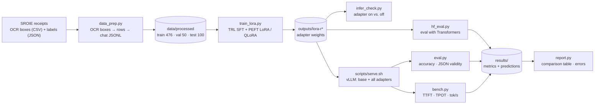

# qwen-receipt-LoRA

Fine-tune **Qwen3-4B-Instruct-2507** with **LoRA / QLoRA** to turn scanned-receipt OCR text into
structured JSON, then serve the base model and several adapters from one **vLLM** server
and measure accuracy and speed.

**Result (Google Colab, Tesla T4):** on 100 held-out SROIE receipts, the share of receipts with all four fields
correct rises from **68 % for the base model to 89–90 % with a QLoRA adapter** (address scored ignoring punctuation;
41 % → 70–71 % with strict exact match). Details in [Results](#3-results-google-colab-tesla-t4).

## 1. Project Overview

Receipts reach a system as noisy OCR text: a shop name mixed with a cashier's name,
five lines that all say "TOTAL", addresses split over several lines. A general instruction
model often gets the format right but the conventions wrong, for example which line is the company
or where an address ends. This project teaches a small open model those conventions cheaply, with LoRA,
using the **SROIE** dataset (626 labelled receipts):

```json
{"company": "KEDAI PAPAN YEW CHUAN", "date": "06/03/2018",
 "address": "LOT 276 JALAN BANTING 43800 DENGKIL, SELANGOR.", "total": "127.20"}
```

It covers the full workflow end to end: data preparation, LoRA/QLoRA training, an adapter sanity check,
multi-adapter serving with vLLM, JSON-schema constrained decoding, and an evaluation and benchmark harness.
The study guide `qwen_lora_vllm_study_guide.html` explains the concepts behind each step
(GitHub shows HTML files as source: download it and open it in a browser).

## 2. Pipeline Diagram



## 3. Results (Google Colab, Tesla T4)

All results in this section were obtained by running **`qwen_receipt_lora_colab.ipynb` on Google Colab with a
Tesla T4 GPU (15 GB)**. The notebook in this repository contains the complete outputs of that run.

| Setting | Value |
|---|---|
| Hardware | Google Colab, NVIDIA Tesla T4 (15 GB, compute capability 7.5): fp16, no bf16 |
| Training stack | torch 2.11.0+cu130 · transformers 5.20.2 · TRL 1.16.0 · PEFT 0.21.2 |
| Serving stack | vLLM 0.32.0 (torch 2.13.0, CUDA 13.0), served with `--dtype half` |
| Method | QLoRA: 4-bit NF4 base model, LoRA on all linear layers, rank 8 / 16 / 32, alpha = 2 × rank |
| Training | 476 receipts, 2 epochs, effective batch 16 (2 × 8 accumulation), learning rate 2e-4, cosine schedule |
| Evaluation | 100 held-out test receipts, greedy decoding; one receipt = 1 percentage point |

### Accuracy (100 test receipts)

| | Base model | LoRA r8 | LoRA r16 | LoRA r32 |
|---|---|---|---|---|
| Company | 79 % | 96 % | 96 % | 95 % |
| Date | 95 % | 99 % | 99 % | 99 % |
| Address (exact) | 52 % | 72 % | 74 % | 74 % |
| Address (ignoring punctuation) | 84 % | 93 % | 95 % | 96 % |
| Total | 100 % | 100 % | 100 % | 100 % |
| **All 4 fields correct (exact)** | **41 %** | **70 %** | **71 %** | **70 %** |
| **All 4 fields correct (address ignoring punctuation)** | **68 %** | **89 %** | **90 %** | **90 %** |
| Valid JSON with the expected keys | 100 % | 100 % | 100 % | 100 % |

Numbers are from `hf_eval.py` (Transformers). Evaluating the same adapters through vLLM gave identical scores;
for the base model vLLM differed by one or two receipts on the address (fp16 numerical differences).
JSON-schema constrained decoding changed no score, because every model already produced valid JSON.

### Training

| Rank | Trainable parameters | Adapter file | Training time | Final eval loss |
|---|---|---|---|---|
| 8 | 16.5 M (0.41 %) | 66 MB | not recorded* | not recorded* |
| 16 | 33.0 M (0.81 %) | 132 MB | 23.9 min | 0.0269 |
| 32 | 66.1 M (1.62 %) | 264 MB | 24.4 min | 0.0250 |

\* The rank-8 training log is not part of the saved notebook output; its evaluation results are.
Adapter files are stored in fp32 (see Troubleshooting). Validation loss still decreased in the second epoch
(r16: 0.0305 → 0.0269, r32: 0.0266 → 0.0250), so there is no sign of overfitting.

### Serving speed with vLLM (T4)

| Measurement | Result |
|---|---|
| Evaluation run, 100 receipts, 16 concurrent requests | base model 1.44–1.49 req/s · adapters 0.85–0.87 req/s |
| One adapter, 1 request at a time (`bench.py`) | 0.12 req/s · 9.8 output tok/s · time to first token 0.53 s · 96 ms per output token |
| One adapter, 8 concurrent requests | 0.75 req/s · 64 output tok/s · 113 ms per output token |
| Three adapters mixed in the same batches, 8 concurrent | 0.36 req/s · 31 output tok/s · 237 ms per output token |

Rank had no measurable effect on speed (r8, r16 and r32 within 2 %).

### Findings

1. **Fine-tuning teaches conventions, not format.** The base model already returns valid JSON and the right total.
   The adapters learn SROIE's labelling conventions: which line is the company (79 % → 96 %) and where the address
   starts and ends (84 % → 95 %, ignoring punctuation).
2. **Rank doesn't matter for this task.** Ranks 8, 16 and 32 are within one receipt of each other on every score,
   so rank 8 is the practical choice: same quality, a quarter of the r32 file size.
3. **Many remaining errors are labelling conventions rather than model mistakes**, for example a date printed as
   `28-03-18` but labelled `28/03/18`, or a company label that joins two printed lines.
4. **Serving adapters has a cost on a T4.** Unmerged adapters reached about 40 % lower throughput than the base model,
   and mixing three adapters in one batch halved throughput again. Merging the adapter (`merge_lora.py`) is the
   obvious next experiment for single-task serving.
5. **The prompt matters.** An earlier prompt asked for the total as "digits only", and the base model then dropped
   the decimal point (`2080` for `20.80`), scoring 40 % on totals in a 20-receipt quick run. The results above use the corrected prompt
   (`src/schema.py`), with which the base model gets 100 %.

**Limitations:** one training run per rank with a single seed; 100 test receipts; Malaysian English receipts only;
speeds are specific to a T4 and the software versions above.

## 4. Project Structure

```
qwen-receipt-lora/
├── README.md
├── .gitignore
├── .env.example                      # optional settings (Hugging Face token, cache, serve.sh options)
├── qwen_receipt_lora_colab.ipynb     # Colab notebook, with the outputs of the T4 run reported above
├── qwen_lora_vllm_study_guide.html   # step-by-step guide with concepts
├── requirements-train.txt            # training env: torch, transformers, trl, peft, bitsandbytes
├── requirements-serve.txt            # serving env: vllm, openai, rapidfuzz
├── scripts/
│   ├── get_data.sh                   # clone SROIE + build the splits
│   ├── serve.sh                      # vLLM server for the base model + trained adapters
│   └── run_experiments.sh            # evaluate + benchmark everything on the server
└── src/
    ├── schema.py                     # fields, JSON schema, prompt (shared by all steps)
    ├── data_prep.py                  # OCR boxes → reading-order text → chat JSONL
    ├── train_lora.py                 # LoRA / QLoRA fine-tuning
    ├── infer_check.py                # quick check: adapter on vs. off
    ├── hf_eval.py                    # evaluation with Transformers (no vLLM)
    ├── eval.py                       # evaluation through the vLLM OpenAI API
    ├── metrics.py                    # parsing, normalisation, exact + punctuation-insensitive scores
    ├── bench.py                      # latency / throughput benchmark
    ├── report.py                     # results table + worst errors
    └── merge_lora.py                 # merge an adapter into the base weights
```

Created at run time and not committed: `data/` (dataset), `outputs/` (adapters), `results/` (metrics, predictions,
benchmarks). The SROIE data is not included in this repository; `scripts/get_data.sh` downloads it from
[zzzDavid/ICDAR-2019-SROIE](https://github.com/zzzDavid/ICDAR-2019-SROIE).

## 5. Prerequisites

| Requirement | Notes |
|---|---|
| NVIDIA GPU with CUDA | 24 GB (RTX 4090, L4, A10) for bf16 LoRA; 16 GB (T4) with `--qlora`. No GPU locally? Use the Colab notebook. |
| Python 3.10+ | Tested with 3.12 (Colab) and 3.13 |
| git, bash | Used by `scripts/get_data.sh` and `scripts/serve.sh` |
| ~15 GB free disk | Base model (~8 GB, downloaded once into the Hugging Face cache), dataset, adapters |
| Internet access | GitHub (SROIE) and Hugging Face (model weights) |

Two separate virtual environments are used: vLLM pins its own PyTorch build, which conflicts with the training stack.

- **Training:** `torch>=2.6`, `transformers>=5.0`, `trl>=1.0`, `peft>=0.17`, `datasets>=3.0`, `accelerate>=1.0`, `bitsandbytes>=0.45`, plus `rapidfuzz` for the metrics.
- **Serving:** `vllm`, `openai>=1.40`, `rapidfuzz>=3.0`.

## 6. Installation and Setup

```bash
# 1. Get the code
git clone <your-repo-url> qwen-receipt-lora && cd qwen-receipt-lora

# 2. Training environment
python -m venv .venv-train
source .venv-train/bin/activate              # Windows: .venv-train\Scripts\activate
pip install -r requirements-train.txt rapidfuzz
python -c "import torch; print(torch.cuda.is_available(), torch.cuda.get_device_name(0))"
deactivate

# 3. Serving environment
python -m venv .venv-serve
source .venv-serve/bin/activate
pip install -r requirements-serve.txt
vllm --version
deactivate
```

**On Google Colab:** upload `qwen_receipt_lora_colab.ipynb`, choose `Runtime → Change runtime type → T4 GPU`, and run all cells.
The notebook writes the project files, installs everything and picks QLoRA + fp16 automatically. By default it trains
ranks 8, 16 and 32 on the full data (about 25 minutes per rank on a T4); set `QUICK = True` in section 5 for a short
pipeline check.

## 7. Configuration

No API keys are required: the model is Apache-2.0 and ungated, and vLLM runs locally without authentication.
Settings come from command-line flags and a few optional environment variables.

**Script flags (main ones)**

| Script | Flag | Default | Purpose |
|---|---|---|---|
| `train_lora.py` | `--model` | `Qwen/Qwen3-4B-Instruct-2507` | Base model |
| | `--rank` / `--alpha` | `16` / `2 × rank` | LoRA capacity and scale |
| | `--targets` | `all` | `all` linear layers or `attn` only |
| | `--epochs` / `--lr` | `2` / `2e-4` | Training length and learning rate |
| | `--batch-size` / `--grad-accum` | `4` / `4` | Effective batch = 16 |
| | `--qlora` | off | Load the base model in 4-bit (16 GB GPUs) |
| | `--full-loss` | off | Also train on prompt tokens |
| | `--out` | `outputs/lora-r16` | Adapter output folder |
| `data_prep.py` | `--layout` | `rows` | `rows` (layout-aware) or `plain` (raw OCR order) |
| `eval.py` | `--model` / `--tag` | required | Model or adapter name to query; name of the result files |
| | `--structured` | off | JSON-schema constrained decoding |
| | `--max-samples` | all (100) | Limit the number of test receipts |
| `hf_eval.py` | `--adapter` / `--n` | required / `50` | Adapter folder; number of test receipts |
| `bench.py` | `--models` / `--concurrency` | required / `1,4,16,32` | Comma-separated models; concurrency levels |

**Environment variables (all optional).** Copy `.env.example` to `.env`, edit it, and load it with
`set -a; source .env; set +a`. `.env` is git-ignored, so a token in it is never committed.

| Variable | Purpose |
|---|---|
| `HF_TOKEN` | Hugging Face token; not needed for this ungated model, only to avoid download rate limits |
| `HF_HOME` | Where model weights are cached (shared by both environments) |
| `BASE`, `ADAPTERS`, `EXTRA_ARGS` | Base model, adapters to register and extra vLLM flags for `scripts/serve.sh` (`--dtype half` on a T4) |
| `VLLM_ALLOW_RUNTIME_LORA_UPDATING` | Allow loading/unloading adapters while the server runs (trusted environments only) |

`serve.sh` registers only the adapters whose folders exist. vLLM settings such as `--max-lora-rank 32`, `--max-loras 4` and
`--max-model-len 4096` are set in `scripts/serve.sh`. Change them there, or override them with `EXTRA_ARGS`.

## 8. How to Run

Run every command from the project root.

```bash
# --- Training environment -------------------------------------------------
source .venv-train/bin/activate

bash scripts/get_data.sh                                    # 1. data → data/processed/

for r in 8 16 32; do                                        # 2. train adapters
  python src/train_lora.py --rank $r --out outputs/lora-r$r  #    (add --qlora on a 16 GB GPU)
done

python src/infer_check.py --adapter outputs/lora-r16 --n 3 --compare   # 3. sanity check
python src/hf_eval.py --adapter outputs/lora-r8  --n 100               # 4. eval without vLLM
python src/hf_eval.py --adapter outputs/lora-r16 --n 100 --skip-base
python src/hf_eval.py --adapter outputs/lora-r32 --n 100 --skip-base
python src/report.py
deactivate

# --- Serving environment --------------------------------------------------
source .venv-serve/bin/activate
bash scripts/serve.sh                  # terminal 1: base model + every adapter in outputs/
bash scripts/run_experiments.sh        # terminal 2: eval (free + JSON-schema) + benchmarks
python src/report.py                   # comparison table
```

`run_experiments.sh` benchmarks `sroie-r16` and the `sroie-r8` + `sroie-r32` mix, so train those ranks first
(or edit its benchmark lines). Optional: `python src/merge_lora.py --adapter outputs/lora-r8 --out outputs/merged-r8`
merges an adapter into a standalone model.

## 9. Example Usage

**Build the data.** `python src/data_prep.py --sroie-dir data/raw/ICDAR-2019-SROIE/data` prints dataset statistics (excerpt):

```
"split": {"train": 476, "val": 50, "test": 100},
"gold_found_verbatim_in_ocr": {"company": 0.974, "date": 0.994, "address": 0.776, "total": 0.998}
```

**Train.** `python src/train_lora.py --rank 16 --qlora --out outputs/lora-r16` reports the adapter size, then logs loss per
step and `eval_loss` per epoch:

```
trainable params: 33,030,144 || all params: 4,055,498,240 || trainable%: 0.8145
...
{'eval_loss': '0.02692', ..., 'eval_mean_token_accuracy': '0.9936', ..., 'epoch': '2'}
adapter saved to outputs/lora-r16
```

**Query the server.** With `serve.sh` running, an adapter is selected by name in the `model` field:

```python
import json
from openai import OpenAI
ex = json.loads(open("data/processed/test.jsonl").readline())
client = OpenAI(base_url="http://localhost:8000/v1", api_key="EMPTY")
r = client.chat.completions.create(model="sroie-r16", messages=ex["prompt"], temperature=0)
print(r.choices[0].message.content)   # {"company": "...", "date": "...", "address": "...", "total": "..."}
```

**Evaluate.** `python src/eval.py --model sroie-r16 --tag sroie-r16-json --structured` printed this in the T4 run:

```
== sroie-r16-json  (sroie-r16, structured=True) ==
strict_json 1.000   json_valid 1.000   schema_valid 1.000
company  exact 0.960   sim 0.991
date     exact 0.990   sim 0.998
address  exact 0.740   sim 0.993
total    exact 1.000   sim 1.000
address  ignoring punctuation 0.950   all fields (address ignoring punctuation) 0.900
macro    exact 0.922   sim 0.995   all-fields-correct 0.710
0.87 req/s, p50 17.577s, p95 22.172s
```

It also writes `results/sroie-r16-json.metrics.json` and `.predictions.jsonl`. `python src/report.py` turns all runs into
one markdown table, and `python src/report.py --errors sroie-r16-json -k 5` lists the worst receipts.

## 10. Testing

There is no unit-test suite. Use these checks to confirm the pipeline works before a full run:

```bash
python -m py_compile src/*.py && for f in scripts/*.sh; do bash -n "$f"; done   # syntax check
python src/data_prep.py --sroie-dir data/raw/ICDAR-2019-SROIE/data   # expect 626 receipts, 0 skipped

# smoke test: train on 64 receipts for one epoch, then check the adapter end to end
head -n 64 data/processed/train.jsonl > data/processed/train_smoke.jsonl
python src/train_lora.py --train data/processed/train_smoke.jsonl --epochs 1 --out outputs/lora-smoke
python src/infer_check.py --adapter outputs/lora-smoke --n 1 --compare
python src/hf_eval.py --adapter outputs/lora-smoke --n 10 && python src/report.py

curl -s localhost:8000/v1/models     # with the server running: base model + adapters listed
```

In the Colab notebook, `QUICK = True` runs the same kind of smoke test (128 receipts, 1 epoch, 20 test receipts).

## 11. Troubleshooting

| Problem | Solution |
|---|---|
| `NotImplementedError: "_amp_foreach_non_finite_check_and_unscale_cuda" not implemented for 'BFloat16'` | QLoRA on a T4: TRL casts LoRA weights to bf16, which fp16 training can't handle. `train_lora.py` keeps them in fp32, which is also why adapter files are twice the bf16 size. |
| `ImportError: Found an incompatible version of torchao` | Old torchao (e.g. Colab's 0.10) is installed. Run `pip uninstall -y torchao`; the project doesn't use it. |
| Training very slow on a T4 | The T4 has no native bf16. The scripts detect this and use fp16. |
| `CUDA out of memory` while training | Add `--qlora`; use `--batch-size 2 --grad-accum 8` (same effective batch); stop any running vLLM server. |
| `loss` is `nan` | fp16 overflow on a T4: try `--lr 1e-4` or a bf16-capable GPU (L4, A100). |
| Installing vLLM breaks PyTorch for training | Keep the two virtual environments separate. |
| vLLM fails with CUDA, driver or `libcudart` errors | The vLLM wheel doesn't match your CUDA driver. Install a vLLM release built for your CUDA version (vLLM 0.32.0 worked on Colab in the reported run). |
| bf16 error when starting vLLM on a T4 | `EXTRA_ARGS="--dtype half" bash scripts/serve.sh` |
| Adapter rejected by vLLM because of its rank | Raise `--max-lora-rank` in `serve.sh` (or via `EXTRA_ARGS`) to at least the largest adapter rank. |
| `run_experiments.sh` stops with `The model 'sroie-r32' does not exist` | It benchmarks `sroie-r16` and `sroie-r8,sroie-r32`. Train those ranks, or edit the two `bench.py` lines. |
| Model not found in `eval.py` | Use the adapter name from `curl localhost:8000/v1/models` (e.g. `sroie-r16`), not the folder path. |
| Fine-tuned results worse through vLLM than with `infer_check.py` | Serve the adapter on the same base model it was trained on (`base_model_name_or_path` in `adapter_config.json`). |
| Results differ from older runs | Adapters trained with the earlier "digits only" prompt aren't comparable; retrain with the current `src/schema.py`. |
| `TypeError` on `torch_dtype`, `warmup_ratio` or `max_seq_length` from older tutorials | Transformers 5 / TRL 1.x use `dtype`, a float `warmup_steps` and `max_length`. |
